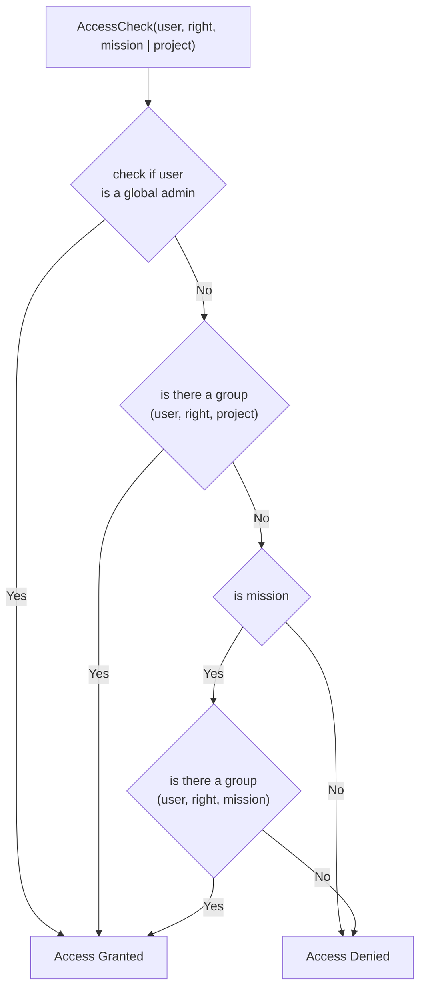

# Access Control - Basic Concepts

This page describes the basic concepts of the access control in the application.

## Principle of Group Based Access Control

The access control is based on groups. Each user can be a member of multiple groups. A group has no rights of its own:
each access a group is granted on a project or a mission has its own `AccessGroupRights`.

| AccessGroupRights | Value |
| ----------------- | ----- |
| READ              | 0     |
| CREATE            | 10    |
| WRITE             | 20    |
| DELETE            | 30    |

### Primary Group

Each user is member of at least one group, their primary group. This group is unique to each user and is created when
the user is created. Only the user itself is member of this group. No other user can be member of this group.

### Affiliation Groups

Affiliation groups are groups to which user are added automatically based on their mail domain.
These groups are configured per deployment in an `access_config.json`; it is not part of the Docker image.
The backend reads it from `ACCESS_CONFIG_PATH` and refuses to start if it is missing or invalid.
The deployment compose files mount the file from `ACCESS_CONFIG_FILE` (default: `./access_config.json` next to the
compose file). Local development and tests use `backend/access_config.dev.json`.

A user matches an entry if their email ends with `@<email>`; subdomains do not match. On every start, the backend
syncs the affiliation groups and memberships of all users with the config: missing groups and memberships are
created, groups are renamed, and groups and memberships no longer covered by the config are removed. Each change is
logged by `AffiliationGroupService`.

#### Example

```json
{
    "emails": [
        {
            "email": "leggedrobotics.com",
            "access_groups": ["00000000-0000-0000-0000-000000000000"]
        }
    ],
    "access_groups": [
        {
            "name": "Kleinkram Developers",
            "uuid": "00000000-0000-0000-0000-000000000000",
            "rights": 10
        }
    ]
}
```

`rights` is the default access the group gets on newly created projects. Changing it does not update existing projects.

Being a member of any affiliation group is also what lets a user create projects, access groups, metadata types and
action templates (everything guarded by `@CanCreate()`, see `ProjectGuardService.canCreate`). The group's `rights` do not
matter here: members of a group with `"rights": 0` can still create projects. Users who are in no affiliation group
cannot create any of these, unless they are admins.

### How a Login is Bound to the Browser

Signing in with Google, GitHub or the fake OAuth provider ends at `/auth/<provider>/callback`, where the provider sends
the browser back with a one-time `code`. Following [RFC 6749, section 10.12](https://www.rfc-editor.org/rfc/rfc6749#section-10.12)
and [RFC 9700, section 4.7](https://www.rfc-editor.org/rfc/rfc9700#section-4.7), the API only accepts a callback in the
browser that started this login. Otherwise an attacker could get a code for their own account and make a victim's
browser open the callback with it, which would sign the victim in to the attacker's account (login CSRF).

- **Start** (`/auth/<provider>`): the browser gets an `oauthlogin` cookie (`httpOnly`, `Secure`, `SameSite=Lax`, path
  `/auth`, 10 minutes). Redis keeps a one-time entry under a random `state`: the hash of that cookie, the PKCE code
  verifier and where the login ends. The provider only sees the `state` and the PKCE challenge (`S256`).
- **Callback:** the entry is taken out of Redis, so each login finishes once, and only counts if the browser sends the
  matching `oauthlogin` cookie. The provider only hands out the account when it gets the PKCE verifier.
- A callback without a matching login (another browser, older than 10 minutes, or used before) is redirected to the
  login page of the frontend with the message "This login was not started in this browser or took too long".

The CLI asks for its end of the login (a local callback port, the page that shows the tokens, or a fake OAuth test
login) with `?state=cli-port-<port>`, `cli-no-redirect` or `cli-direct` when it starts the login; the API stores this
with the login and does not take it from the callback. Logins started in two tabs at the same time share the cookie and
each keep their own `state`.

### Restricting Sign-In to Internal Users

By default anyone with a Google or GitHub account can sign in; users whose email matches no entry in `emails` get an
account without affiliation groups ("external" users). A deployment that should only be open to its own organization
sets `allow_external_users` to `false`:

```json
{
    "allow_external_users": false,
    "emails": [
        {
            "email": "roboticscorp.com",
            "access_groups": ["00000000-0000-0000-0000-000000000000"]
        }
    ],
    "access_groups": [
        {
            "name": "RoboticsCorp",
            "uuid": "00000000-0000-0000-0000-000000000000",
            "rights": 10
        }
    ]
}
```

The option is optional and defaults to `true` (no restriction). With `false`, `emails` must not be empty, and:

- **Sign-up:** a new account is only created for a **verified** email address on one of the domains in `emails`. GitHub
  accounts are checked against all their verified addresses (the primary one is preferred), so a user whose primary
  address is private but who verified a work address on GitHub can sign in; the work address becomes the account's
  email. Google accounts are checked against their email address, which must be verified
  (`email_verified`).
- **Login of an existing user:** the email stored for the user must be on an allowed domain, and the provider must still
  report a verified address on an allowed domain. A user who removed the work address from their GitHub account can no
  longer sign in.
- **Running sessions:** refreshing a session and every request with an access token check the stored email again, so
  after the backend restarts with the restriction, sessions of external users end at once (the API answers `401`).
- **Admins are not exempt.** An admin with an external email is locked out like any other user; add their domain or
  give the role to an internal user before switching the restriction on.

A refused login is redirected to the login page of the frontend, which shows the reason. The fake OAuth provider used in
development and tests counts its email as verified. API keys of actions are not affected.

## How Access is Checked?

Below is the default check for access rights. For the case of authentication using Api Keys, as used in actions, a
different flow is used.


