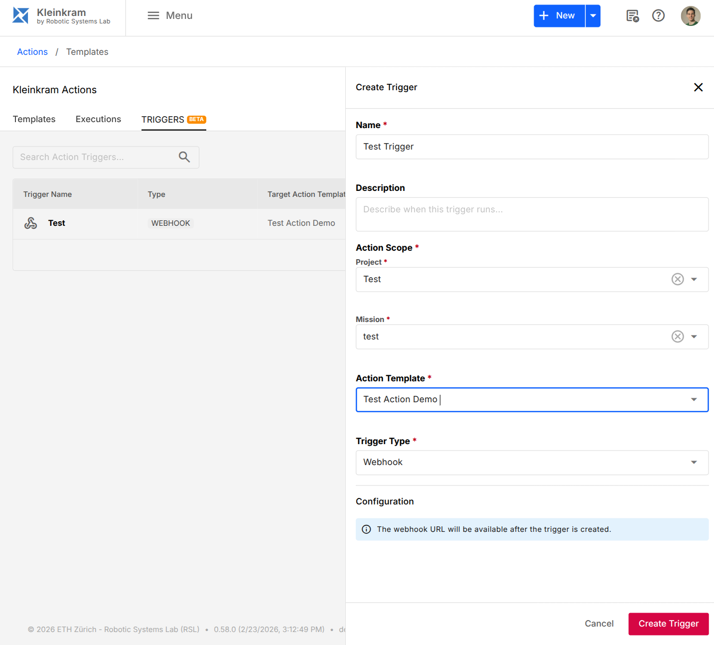

# Action Triggers

Action triggers allow you to automate the execution of your actions based on specific events or schedules. Besides the
web interface, you can manage triggers with `klein trigger` (see the [CLI Reference](../python/cli.md#kleinkram-actions))
and with the [Python SDK](../python/sdk.md#kleinkram-actions).



Kleinkram supports three types of triggers:

| Trigger Type (in the web app) | Description    | Example Use Case                                                          |
| ----------------------------- | -------------- | ------------------------------------------------------------------------- |
| Time Schedule (Cron)          | Schedule-based | Generate a report with summary statistics daily at midnight.              |
| Webhook                       | Event-based    | Run a verification action as soon as a new docker image version is pushed |
| File Watcher                  | Data-based     | Run a post-processing action as soon as a new file is uploaded            |

Every trigger belongs to one action template and one mission: the action always runs on that mission, with the
access rights of the user who created the trigger.

To create a trigger, open the **Actions** page, go to the **Triggers** tab and click **New Trigger**. Give the trigger a
name, pick the mission and the action template, then choose the trigger type and fill in its configuration.

## Time Schedule (Cron) Triggers

Cron triggers allow you to schedule actions to run periodically at fixed times or intervals. This is useful for regular maintenance tasks, nightly reports, or periodic data synchronization.

To set up a cron trigger:

1. On the **Triggers** tab of the **Actions** page, click **New Trigger**.
2. Enter a name, pick the mission and the action template, and select **Time Schedule (Cron)** as the Trigger Type.
3. Enter a valid cron expression (e.g., `0 0 * * *` for daily at midnight).
4. Click **Create Trigger**.

The action will now run automatically based on the scheduled cron expression.

::: tip Cron Syntax
Kleinkram uses standard cron syntax. You can use sites like [crontab.guru](https://crontab.guru/) to help generate expressions.
Kleinkram checks the schedules once a minute, in the time zone of the server (usually UTC).
:::

## Webhook Triggers

Webhook triggers allow external systems to trigger Kleinkram actions via HTTP requests. This enables integration with CI/CD pipelines, external data sources, or other tools in your ecosystem.

To set up a webhook trigger:

1. On the **Triggers** tab of the **Actions** page, click **New Trigger**.
2. Enter a name, pick the mission and the action template, and select **Webhook** as the Trigger Type.
3. Click **Create Trigger**.

Kleinkram will generate a unique **Webhook URL** for this trigger. You can now send a `POST` request to this URL to trigger the action.

### Triggering the Webhook

Send a POST request to the webhook URL to trigger the action. The URL points at the Kleinkram API (not the web app) and has the form `<API_URL>/hooks/actions/<TRIGGER_UUID>`.

```bash
curl -X POST https://<your-kleinkram-api>/hooks/actions/<TRIGGER_UUID>
```

The request needs no authentication: anyone who knows the URL can start the action, so treat the URL like a password.
The action runs with the access rights of the user who created the trigger.

- A `GET` request to the same URL also starts the action.
- A `POST` body is optional. If you send one, it must be a JSON object of at most 100 KB. Kleinkram does not pass it on
  to the action container.
- `POST` requests are limited to 10 per minute per client IP address. Further requests are answered with `429 Too Many Requests`.
- The response contains the ID of the new execution (`actionUUID`), the template ID (`templateUUID`), its state and
  creation time.

## File Watcher Triggers

File watcher triggers allow you to automatically run an action when a file matching a pattern arrives in the trigger's
mission. This is perfect for processing pipelines, such as automatically converting new bag files or analyzing newly
uploaded images.

To set up a file watcher trigger:

1. On the **Triggers** tab of the **Actions** page, click **New Trigger**.
2. Enter a name, pick the mission to watch and the action template, and select **File Watcher** as the Trigger Type.
3. Enter one or more **glob patterns** (press Enter after each). A file only needs to match one of them.
4. Click **Create Trigger**.

The action now runs on the trigger's mission whenever a matching file is uploaded to it, copied or moved into it, or
renamed within it. Files in other missions do not start the trigger; create one trigger per mission you want to watch.
Without a pattern, every file starts the action.

### Glob Pattern Examples

Kleinkram flattens all uploaded files, meaning **filenames do not contain folders or slashes**. Therefore, your glob patterns should only match against the filename itself.

| Pattern             | Description                                                                                            |
| ------------------- | ------------------------------------------------------------------------------------------------------ |
| `*.bag`             | Matches any `.bag` file.                                                                               |
| `2026-*.yaml`       | Matches any `.yaml` file starting with `2026-`.                                                        |
| `*_processed.db3`   | Matches any `.db3` file ending in `_processed`.                                                        |
| `mission-10-?.mcap` | Matches files like `mission-10-A.mcap` or `mission-10-1.mcap` using the `?` single-character wildcard. |

::: tip
Patterns use [minimatch](https://github.com/isaacs/minimatch) syntax: `*` matches any character sequence, `?` a single
character, `{bag,mcap}` one of several alternatives and `[0-9]` one character from a set. Patterns also match files
whose name starts with a dot.
:::
